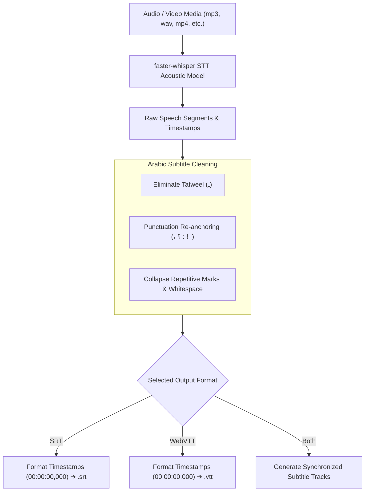

# 🎬 arabic-whisper-srt

[](https://github.com/MobileConduit/arabic-whisper-srt/actions/workflows/ci.yml)
[](LICENSE)
[](https://github.com/MobileConduit)
[](https://github.com/SYSTRAN/faster-whisper)
[](https://python.org)

A dedicated Arabic Speech-to-Text subtitle engine powered by `faster-whisper`. Designed specifically to handle Arabic dialects, formal Arabic (Fusha), correct punctuation placement (فاصلة عربية، علامات استفهام), and generate timed `.srt` and `.vtt` tracks.

---

## 🏛 Architecture & Processing Pipeline



---

## 🌟 Highlights & Capabilities

- **Sub-word Timing & Proper RTL Segmentation**: Prevents broken Arabic phrases across subtitle boundaries.
- **RTL Punctuation Correction**: Fixes misaligned punctuation marks (Arabic comma `،`, question mark `؟`, semicolon `؛`) so they render on the correct side of the screen.
- **Dual Export Formats**: Native support for SubRip (`.srt`) and WebVTT (`.vtt`) formats.
- **Optimized with `faster-whisper`**: Up to 4x faster execution and lower VRAM usage compared to vanilla Whisper.
- **Offline & Simulation Mode**: Built-in benchmark demo mode to test workflows without downloading model weights.

---

## 🚀 Installation & Usage

```bash
git clone https://github.com/MobileConduit/arabic-whisper-srt.git
cd arabic-whisper-srt
pip install -r requirements.txt
```

### Transcribe Media to SRT:
```bash
python whisper_srt.py --input interview.mp4 --model medium --output interview.srt
```

### Export Both SRT and WebVTT Tracks:
```bash
python whisper_srt.py --input lecture.wav --model small --format both
```

### Run Demo Simulation (Zero Model Download):
```bash
python whisper_srt.py --input demo --format both --demo
```

---

## 📦 Python API Usage

```python
from pathlib import Path
from whisper_srt import generate_srt, generate_vtt, clean_arabic_text

# Clean transcribed Arabic text
clean = clean_arabic_text("مرحبا بكم في المؤتمر  ، نحن سعداء بلقائكم ؟")
print(clean)
# Output: مرحبا بكم في المؤتمر، نحن سعداء بلقائكم؟

# Generate SRT programmatically
segments = [
    {"start": 0.5, "end": 3.8, "text": "أهلاً بكم في هذا العرض التقديمي."},
    {"start": 4.1, "end": 7.5, "text": "تم تطوير هذا النظام بواسطة المهندس شادي الحسن."}
]

generate_srt(segments, Path("output.srt"))
generate_vtt(segments, Path("output.vtt"))
```

---

## ⚙️ Configuration (.env)

A `.env.example` template is provided for environment configuration:
```bash
cp .env.example .env
```

Configuration variables:
- `WHISPER_MODEL`: Default model size (`tiny`, `base`, `small`, `medium`, `large-v3`).
- `WHISPER_LANGUAGE`: Language code (default: `ar`).
- `WHISPER_DEVICE`: Execution device (`auto`, `cuda`, `cpu`).
- `WHISPER_COMPUTE_TYPE`: Precision type (`auto`, `float16`, `int8`).
- `DEFAULT_SUBTITLE_FORMAT`: Default output format (`srt`, `vtt`, `both`).

---

## 🧪 Running Automated Tests

Run the unit tests verifying timestamp formatting, segment validation, text normalization, and subtitle generation:

```bash
python -m unittest discover tests -v
```

---

## 👤 Author & Maintainer

**Eng. MHD. Shadi AL-Hasan**  
- **Role:** Executive CTO & Enterprise Solutions Architect  
- **Email:** [mhd.shadi.alhasan@gmail.com](mailto:mhd.shadi.alhasan@gmail.com)  
- **Phone / WhatsApp:** [+963934005922](tel:+963934005922)  
- **Location:** Damascus, Syria  
- **GitHub:** [MobileConduit](https://github.com/MobileConduit)  

---

## 📄 License

This project is licensed under the MIT License - see the [LICENSE](LICENSE) file for details.  
Copyright (c) 2026 **MHD. Shadi AL-Hasan**. All rights reserved.
